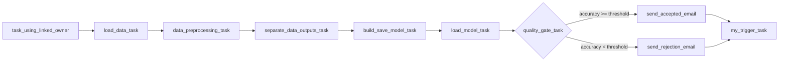
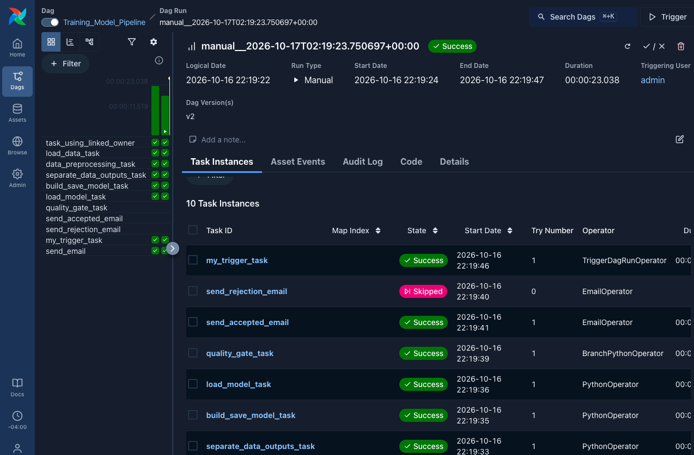
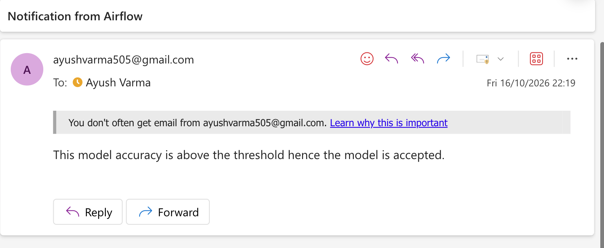
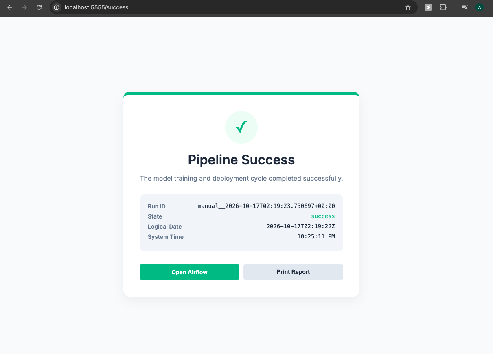

# Airflow Lab 2: ML Pipeline with a Quality Gate, Email Alerts, and a Flask Status Page

This lab uses **Apache Airflow 3** to orchestrate a small machine learning pipeline. It trains a logistic regression model on an advertising dataset, evaluates it, decides through a **quality gate** whether the model is accepted, emails the result, and then starts a **Flask web page** that reports the status of the latest pipeline run by querying Airflow's REST API.

**Author:** Ayush Varma ([@ayushvarma7](https://github.com/ayushvarma7))
**Repository:** [github.com/ayushvarma7/lab_02](https://github.com/ayushvarma7/lab_02)

Based on [Airflow Lab 2](https://github.com/raminmohammadi/MLOps/tree/main/Labs/Airflow_Labs/Lab_2) from Prof. Ramin Mohammadi's MLOps course.

---

## 1. What this project does

The project has two DAGs.

**`Training_Model_Pipeline`** (`dags/main.py`): the batch training pipeline.



| Task | What it does |
|---|---|
| `task_using_linked_owner` | Demo BashOperator showing a task owner linked to a GitHub profile |
| `load_data_task` | Reads `advertising.csv` and saves it as a pickle in `working_data/` |
| `data_preprocessing_task` | Drops text columns, splits train/test (70/30), scales features |
| `separate_data_outputs_task` | Passes the preprocessed file path through |
| `build_save_model_task` | Trains `LogisticRegression` and saves it to `model/model.sav` |
| `load_model_task` | Reloads the model, evaluates it on the test set, returns accuracy and F1 |
| `quality_gate_task` | Compares accuracy with the `accuracy_threshold` Param and picks one email branch |
| `send_accepted_email` / `send_rejection_email` | Emails the result; the branch not chosen is skipped |
| `my_trigger_task` | Starts the `WebService_Flask` DAG (runs whichever branch was taken) |

Tasks hand data to each other as **file paths** through XCom. The actual DataFrames and model live as files in `working_data/` and `model/`, because XCom in Airflow 3 only carries small JSON values.

**`WebService_Flask`** (`dags/Flask_API.py`): a status page. Its single task starts a Flask server on port **5555**. When you open the page, Flask gets a token from Airflow (`/auth/token`), asks the Airflow REST API for the latest `Training_Model_Pipeline` run, and shows a success or failure page.

---

## 2. Changes I made

### Change 1: Quality gate with a branch, a DAG Param, and XCom metrics

**Original behavior:** the pipeline trained and evaluated the model, but the accuracy was only printed to the log. Nothing in the DAG acted on it, so a bad model went through the same path as a good one.

**New behavior:**

1. `load_model` (in `dags/src/model_development.py`) now **returns a metrics dict** (`accuracy`, `f1`, `first_prediction`) instead of the first prediction. Values are cast to plain `float`/`int` so they are JSON-serializable for XCom.
2. A new **`BranchPythonOperator`** (`quality_gate_task`) pulls those metrics from XCom and compares accuracy with a threshold. It returns the `task_id` of the branch to follow; Airflow marks the other branch as **skipped**.
3. The threshold is a **DAG Param** (`accuracy_threshold`, default `0.9`, limited to 0 to 1). It can be changed per run from the trigger form in the UI, without editing code.
4. Two email tasks replace the single original one: **`send_accepted_email`** and **`send_rejection_email`**.
5. Both branches join into `my_trigger_task`, which keeps `TriggerRule.ALL_DONE`. Skipped counts as done, so the Flask status page starts on both paths, and also when something fails.

**Airflow concepts used:** `BranchPythonOperator`, XCom (`ti.xcom_pull`), DAG `params`, context injection (`ti`, `params`), skip propagation, and trigger rules on a join task.

<!-- Add Change 2 and Change 3 sections here in the same format once implemented. -->

### Supporting changes needed to run the lab locally on Airflow 3

These are not the graded changes, but without them the lab does not run outside the author's Docker setup.

| Problem in the original lab | Fix |
|---|---|
| `model_development.py` hardcoded `/opt/airflow/...`, a path that only exists inside Airflow's Docker image, so DAG import failed with `PermissionError` | Paths now come from `AIRFLOW_HOME` (falls back to `/opt/airflow` in Docker) |
| `Flask_API.py` pointed at `http://airflow-apiserver:8080` (a Docker container name) with Docker's default login | Configured through environment variables in `env.sh`: `AIRFLOW_WEBSERVER`, `AIRFLOW_USERNAME`, `AIRFLOW_PASSWORD`, `TARGET_DAG_ID` |
| The email task was commented out and not in the dependency chain | Replaced by the two branch email tasks (Change 1) |
| The README configures email in `airflow.cfg` (Airflow 2 method), but the Airflow 3 `EmailOperator` reads the `smtp_default` connection | Connection defined through `AIRFLOW_CONN_SMTP_DEFAULT` in `env.sh` |
| DAG IDs | Renamed to `Training_Model_Pipeline` and `WebService_Flask`; trigger and Flask config updated to match |

---

## 3. Requirements

| Requirement | Version | Notes |
|---|---|---|
| OS | macOS or Linux | Windows users: use WSL2 |
| Python | **3.12** | Airflow 3 does not support Python 3.14. Tested with Homebrew Python 3.12 |
| apache-airflow | `FILL_IN` | Output of `airflow version` |
| apache-airflow-providers-smtp | `FILL_IN` | Output of `pip show apache-airflow-providers-smtp` |
| Git | any recent | |
| Gmail account | with 2-Step Verification on | Needed to create an App Password for sending email |

Python packages are listed in `requirements.txt`.

---

## 4. Setup from scratch

All commands run from the project folder unless stated otherwise.

### 4.1 Install Python 3.12 (macOS)

If you don't have Homebrew, install it from [brew.sh](https://brew.sh). Then:

```bash
brew install python@3.12
/opt/homebrew/bin/python3.12 --version
```

On Linux, install Python 3.12 with your package manager.

### 4.2 Clone the repo and create a virtual environment

```bash
git clone https://github.com/ayushvarma7/lab_02.git
cd lab_02
/opt/homebrew/bin/python3.12 -m venv .venv
source .venv/bin/activate
pip install --upgrade pip
pip install -r requirements.txt
```

The virtual environment keeps every package inside `.venv/`, so nothing is installed globally.

### 4.3 Create a Gmail App Password

1. Make sure 2-Step Verification is on for your Google account.
2. Go to [myaccount.google.com/apppasswords](https://myaccount.google.com/apppasswords) and create a password named `airflow`.
3. Copy the 16 characters **without spaces**.

### 4.4 Create `env.sh`

```bash
cp env.sh.example env.sh
```

Open `env.sh` and fill in:

* `YOUREMAIL@gmail.com` (twice) and the App Password in `AIRFLOW_CONN_SMTP_DEFAULT`
* `AIRFLOW_PASSWORD` (you get this value in step 4.5)

Rules for this file: no spaces around `=`, and keep the single quotes around the SMTP JSON. `env.sh` holds passwords and is ignored by git.

### 4.5 First start: get the admin password

```bash
source .venv/bin/activate
source env.sh
airflow standalone
```

`airflow standalone` creates the database, an admin user, and starts all Airflow components (API server, scheduler, DAG processor, triggerer) in one terminal.

Get the generated password from another terminal:

```bash
cat simple_auth_manager_passwords.json.generated
```

Put it in `env.sh` as `AIRFLOW_PASSWORD`, stop Airflow with **Ctrl+C**, and start it again (step 5.1). The restart is required: the Flask task reads these variables from the environment Airflow was started in.

### 4.6 Set the email recipient

In `dags/main.py`, change `to=` in both `send_accepted_email` and `send_rejection_email` to your address.

---

## 5. Running the pipeline

### 5.1 Start Airflow

Every time, from the project folder:

```bash
source .venv/bin/activate
source env.sh
airflow standalone
```

`env.sh` sets `AIRFLOW_HOME=$PWD`, so it must be sourced from the project folder.

### 5.2 Open the UI

Go to [http://localhost:8080](http://localhost:8080) and log in as `admin` with the generated password. You should see `Training_Model_Pipeline` and `WebService_Flask` with no "DAG Import Errors" banner.

### 5.3 Run the accept path

1. Turn on the toggle for `Training_Model_Pipeline` (new DAGs start paused).
2. Click **▶ Trigger** and keep `accuracy_threshold` at `0.9`.

### 5.4 Run the reject path

1. If a `WebService_Flask` run is still running from before, mark it as success first (the new run needs port 5555).
2. Click **▶ Trigger**, set `accuracy_threshold` to `0.99`, and trigger.

---

## 6. What a successful run looks like

**Accept path (threshold 0.9):**

* Grid view: all tasks green except `send_accepted_email`'s sibling `send_rejection_email`, which shows **skipped**.
* `quality_gate_task` log: `Model accuracy: 0.9xxx vs threshold=0.9`.
* Email received: **"Notification from Airflow"**.
* `WebService_Flask` has a **running** run (the Flask server).
* [http://localhost:5555/](http://localhost:5555/) redirects to `/success` and shows the run ID and state `success`.

**Reject path (threshold 0.99):**

* `send_rejection_email` green, `send_accepted_email` **skipped**, `my_trigger_task` green.
* Email received: **"Model Accuracy Below Threshold"**.

**Files created:** `working_data/raw.pkl`, `working_data/preprocessed.pkl`, `model/model.sav`.

### Screenshots

**Accept path: run details.** The quality gate chose `send_accepted_email`; `send_rejection_email` is skipped, and `my_trigger_task` still ran because of `ALL_DONE`.



**Accept path: email received.**



**Flask status page** at `http://localhost:5555/success`.



<!--
Reject path screenshots (trigger with accuracy_threshold = 0.99), then uncomment:

**Reject path: run details.**


**Reject path: email received.**


-->


---

## 7. Troubleshooting

| Symptom | Cause and fix |
|---|---|
| `airflow` fails to install or import | Wrong Python version. Recreate `.venv` with Python 3.12 |
| `source env.sh` prints `... not found` or `not a valid identifier` | A space around `=` in `env.sh`. Use `NAME=value` |
| A DAG is missing and the UI shows "DAG Import Errors" | Read the error in the banner. A path error means `AIRFLOW_HOME` was not set; run `source env.sh` from the project folder |
| Email task fails with a connection error | `AIRFLOW_CONN_SMTP_DEFAULT` missing or wrong; check the App Password and that `env.sh` was sourced before `airflow standalone` |
| Flask page shows "Authentication failed" | `AIRFLOW_PASSWORD` does not match `simple_auth_manager_passwords.json.generated` |
| `start_Flask_API` fails with `Address already in use` | A previous Flask run still holds port 5555. Mark it success in the UI, or run `lsof -i :5555` and stop that process |
| Tasks crash with `SIGSEGV` on macOS | `NO_PROXY` and `OBJC_DISABLE_INITIALIZE_FORK_SAFETY` not set; source `env.sh` |

---

## 8. Cleanup

Nothing is installed outside the project folder.

```bash
deactivate
rm -rf .venv logs working_data model/model.sav airflow.db airflow.cfg
```